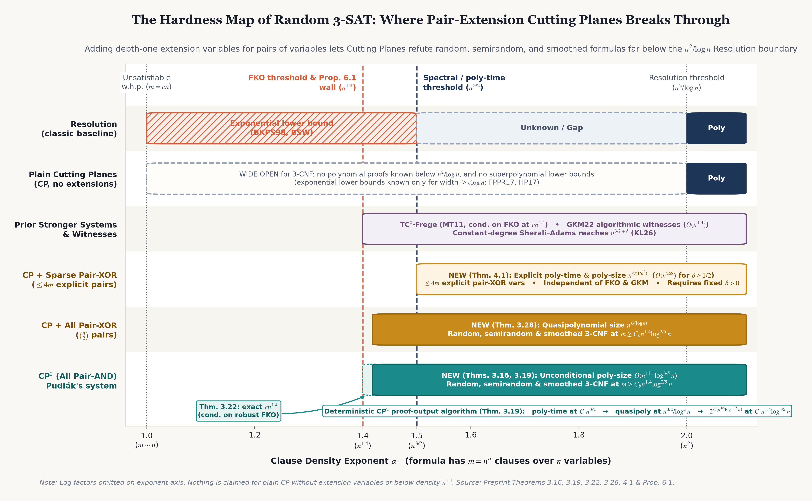
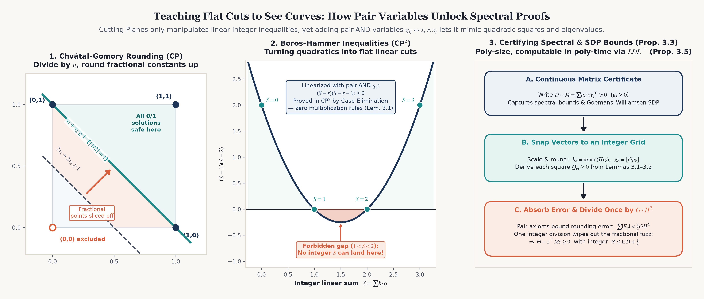
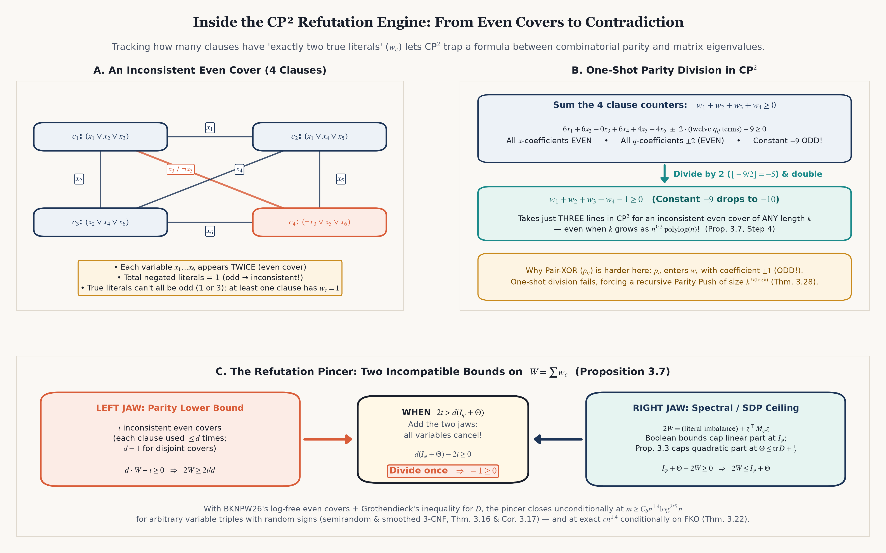
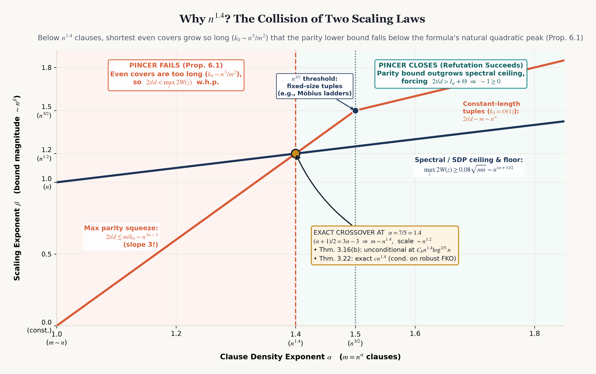
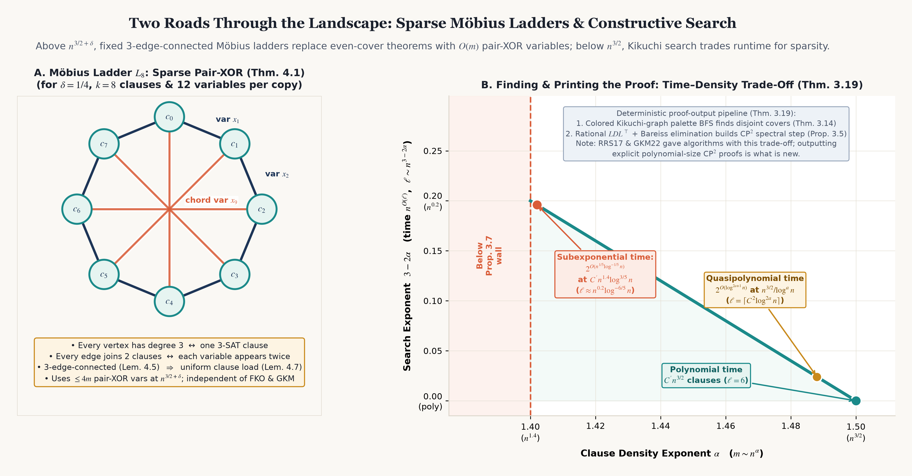

# Teaching Flat Cuts to Count Loops: How Pair Variables Crack Random 3-SAT Below the $n^{3/2}$ Barrier

*Cutting planes—the austere proof system built from flat inequalities and integer rounding—has no known short refutations of moderately dense random logic puzzles. A new paper shows that giving it "pair vision" unlocks eigenvalue proofs and semidefinite bounds, and maps exactly where its method gives out: at $n^{1.4}$ clauses.*

*This article overview was written by AI, just like the paper itself. So why do any of this? Because this is something LLMs are good at: identifying a novel synthesis of existing math concepts. The paper fully credits the real mathematicians whose work provided the foundation.*

**Paper:** [paper.pdf](paper.pdf) (37 pages; the AI disclosure is under the abstract on page 1).

---

Imagine a switchboard with $n$ toggle switches and $m$ three-way safety interlocks. Each interlock forbids one specific combination of three switches—say, "switches 1, 2, and 3 cannot all be off." In computer science, this puzzle is called **3-CNF** (or **3-SAT**). If you wire up just a handful of interlocks, the switchboard is easy to satisfy. Pile on more than a large constant multiple of $n$ random interlocks, however, and the board locks up completely: with overwhelming probability, **no setting of the switches works**.

Yet knowing a puzzle is impossible and *writing down a short, unassailable proof* of its impossibility are two radically different things.

In proof complexity, the central question is how long a formal certificate of unsatisfiability—a **refutation**—has to be when $n$ is large and the formula has $m$ clauses. Think of $m$ as a density dial tuned by an exponent $\alpha$, where $m = n^{\alpha}$. Near $m = c n$ ($\alpha = 1$), random 3-CNF formulas are already unsatisfiable, yet **Resolution**—the classic logic engine behind modern SAT solvers—needs exponentially long proofs, and keeps needing them until the density approaches $n^{3/2}$. Only when $m$ reaches roughly $n^2 / \log n$ ($\alpha \approx 2$) does Resolution find short, polynomial-size proofs. Between those poles lies a vast desert where clauses are sparse enough that local contradictions vanish, yet dense enough that global structure secretly dooms every assignment.

For decades, one of the most tantalizing residents of that desert has been **Cutting Planes** ($\mathrm{CP}$), rooted in the Chvátal–Gomory integer-rounding formulation (1973) and formalized as a propositional proof system by W. Cook, C. R. Coullard, and Gy. Turán in 1987. Unlike Resolution, which argues by pure case-by-case Boolean elimination, Cutting Planes translates clauses into linear inequalities over $0/1$ variables and uses just two elementary moves: take nonnegative integer combinations of existing inequalities, and divide an inequality by a common integer factor, rounding any fractional constant to seal away impossible half-integer solutions.

That single rounding rule gives Cutting Planes genuine arithmetic muscle—it can effortlessly count things that force Resolution into exponential blowups. Yet for **random 3-CNF**, plain Cutting Planes remains an enigma. Researchers have proved exponential lower bounds on $\mathrm{CP}$ for random formulas whose clauses grow logarithmically with $n$, and P. Hrubeš and P. Pudlák stated their belief that random 3-CNF is hard for plain $\mathrm{CP}$ too. Still, no superpolynomial lower bound for plain $\mathrm{CP}$ on random 3-CNF is known—and the paper knows of no polynomial-size $\mathrm{CP}$ refutation below Resolution's $n^2 / \log n$ range either.

Now a new 37-page paper, *"Cutting planes with pair extension variables and random 3-CNF,"* changes the picture for Cutting Planes augmented with a remarkably modest upgrade: **pair extension variables**. Rather than giving $\mathrm{CP}$ unrestricted new variables (with which it could simulate Extended Resolution, a vastly stronger system), the paper allows depth-one helper variables defined strictly from pairs of original variables—either the **pair-AND** $q_{ij} \leftrightarrow x_i \wedge x_j$ or the **pair-XOR** $p_{ij} \leftrightarrow x_i \oplus x_j$. With all $\binom{n}{2}$ pair-AND variables, the system is P. Pudlák's quadratic cutting-planes system **$\mathrm{CP}^2$** (2003), which still forbids multiplying an inequality by a variable.

The paper's headline finding is that "pair vision" brings Cutting Planes down to within a small logarithmic factor of the celebrated $n^{1.4}$ frontier. Using all pair-AND variables ($\mathrm{CP}^2$), random and semirandom 3-CNF formulas with $m \ge C_b n^{1.4}\log^{2/5} n$ clauses have, with high probability, polynomial-size refutations—$O(n^{11.1}\log^{3/5} n)$ lines with polynomially bounded coefficients—and so do smoothed formulas at that density, provided enough of their clauses are re-randomized. At exactly $c n^{1.4}$ clauses, polynomial-size refutations exist if one assumes the robust form of a 2006 theorem of Feige, Kim, and Ofek, whose published proof is only sketched in places. With all pair-XOR variables instead, the same unconditional densities yield quasipolynomial-size ($n^{O(\log n)}$) proofs. And above $n^{3/2+\delta}$ clauses, a completely self-contained construction needs only $O(m)$ explicitly chosen pair-XOR variables—a sliver of all pairs—to refute random formulas in polynomial size and polynomial time for each fixed $\delta$.

*Figure 1: **The hardness map of random 3-SAT.** Across clause densities $m = n^\alpha$, Resolution requires exponential proof size below $n^{3/2}$ and becomes polynomial only near $n^2 / \log n$, while plain Cutting Planes ($\mathrm{CP}$) remains open across the entire middle band. Adding depth-one pair-extension variables pushes $\mathrm{CP}^2$ (all pair-ANDs) unconditionally down to $C_b n^{1.4}\log^{2/5} n$ (and exact $cn^{1.4}$ conditionally on robust FKO), yields quasipolynomial proofs with all pair-XORs, and achieves explicit polynomial-time/polynomial-size refutations with at most $4m$ pair-XORs above $n^{3/2+\delta}$. No claims are made for plain $\mathrm{CP}$ without extensions, and no refutations are claimed below density $n^{1.4}$.*

---

## Teaching Flat Cuts to See Eigenvalues

To understand why adding simple variables like $q_{ij} \leftrightarrow x_i \wedge x_j$ transforms Cutting Planes, it helps to picture what Cutting Planes normally can and cannot see.

Every plain $\mathrm{CP}$ line is a flat hyperplane slicing through the $n$-dimensional unit hypercube $\{0,1\}^n$. The Chvátal–Gomory division step lets $\mathrm{CP}$ nudge a hyperplane inward whenever all its variable coefficients share a common integer divisor—for instance, turning $2x_1 + 2x_2 \ge 1$ into $x_1 + x_2 \ge 1$, slicing off a fractional corner while preserving every $0/1$ corner. What plain $\mathrm{CP}$ lacks is a way to reason about *curvature*: quadratic expressions like $(\sum_i b_i z_i)^2 \ge 0$ or the eigenvalues of a matrix, which are the bread and butter of spectral algorithms and semidefinite programming (SDP).

In stronger proof systems like Lovász–Schrijver ($\mathrm{LS}_+$) or Sum-of-Squares, you are handed the square rule $\ell^2 \ge 0$ for free, or you are allowed to multiply inequalities directly by variables. Pudlák's $\mathrm{CP}^2$ has *neither* rule. Each $q_{ij}$ is just another $0/1$ variable tied down by a few tiny linear axioms, such as $x_i - q_{ij} \ge 0$, $x_j - q_{ij} \ge 0$, and $q_{ij} - x_i - x_j + 1 \ge 0$. How can flat axioms mimic a parabola?

The paper's first technical pillar (Sections 3.1–3.4) answers that question in three steps:

1. **The Integer Gap Trick (Boros–Hammer inequalities without multiplication).** Consider any integer-weighted sum $S = \sum_{i=1}^s b_i x_i$ and any integer $r$. Because $S$ must take an integer value on every $0/1$ assignment, it can never land strictly between two consecutive integers $r$ and $r+1$. Consequently, the quadratic expression $(S - r)(S - r - 1)$ is *always* at least $0$ on integers—it dips below zero only in the forbidden fractional interval $(r, r+1)$. Using the pair variables $q_{ij}$ in place of $x_i x_j$, that parabola turns into a linear inequality $L_s(r) \ge 0$, known as a **Boros–Hammer inequality** of the Boolean quadric polytope. In Lemma 3.1, the paper proves that $\mathrm{CP}^2$ can derive every Boros–Hammer inequality in pseudo-polynomial size (polynomial in $s$ and $\sum |b_i| + |r|$) by adapting an induction of Grigoriev, Hirsch, and Pasechnik—replacing variable-multiplication rules with a clean "case elimination" lemma (Lemma 2.4) built purely from Chvátal–Gomory divisions and the pair-AND axioms.

2. **Summing Squares (Lemma 3.2).** Expanding the linear form $Q_b$ that represents $(\sum_i b_i z_i)^2$ in spin coordinates $z_i = 1 - 2x_i \in \{\pm 1\}$ turns out to be either $4L_n(r) + 1$ (if $B = \sum b_i = 2r + 1$ is odd) or $2L_n(r) + 2L_n(r-1)$ (if $B = 2r$ is even). Thus $\mathrm{CP}^2$ derives $Q_b \ge 0$—and even $Q_b - 1 \ge 0$ when $B$ is odd—from just one or two Boros–Hammer lines.

3. **Snapping Eigenvalues onto an Integer Grid (Propositions 3.3 and 3.5).** Now take *any* symmetric $n \times n$ matrix $M$ with zero diagonal and half-integral entries ($2M_{ij} \in \mathbb{Z}$), and *any* diagonal matrix $D$ such that $D - M$ is positive semidefinite ($D - M \succeq 0$). Decomposing $D - M = \sum_{k=1}^n \mu_k v_k v_k^\top$ gives real eigenvectors $v_k$ and nonnegative eigenvalues $\mu_k$—objects full of irrational square roots that $\mathrm{CP}^2$ cannot express directly. Following an integer-approximation strategy reminiscent of Müller and Tzameret (2012), the paper scales each vector $v_k$ by a large integer $H = \lceil 8n^{3/2}\tau \rceil$ (where $\tau = \max(1, \mathrm{tr}\,D)$) and rounds every coordinate to the nearest integer $b_k$, while rounding $G\mu_k$ down to $g_k = \lfloor G\mu_k \rfloor$ for $G = 16n^2$. Summing $g_k Q_{b_k} \ge 0$ gives an integer approximation to the matrix inequality. Crucially, every tiny rounding discrepancy $E_{ij}$ multiplies a spin product $Y_{ij} = z_i z_j \in \{\pm 1\}$, whose bounds $1 \pm Y_{ij} \ge 0$ follow directly from the pair axioms. By choosing $H$ and $G$ large enough, the sum of all rounding errors totals strictly less than $\frac{1}{2}GH^2$. **One single Chvátal–Gomory division by $GH^2$ wipes out the entire fractional rounding fuzz** and yields an exact integer line certifying $z^\top M z \le \Theta$ with $\Theta \le \mathrm{tr}\,D + \frac{1}{2}$.

Remarkably, this certifies not only largest-eigenvalue spectral bounds ($D = \lambda_{\max}(M)\,I$) in $\mathrm{CP}^2$, but *any* diagonal semidefinite bound—including the classic **Goemans–Williamson SDP upper bound on Max-Cut** up to an additive constant, in size polynomial in $n$ and the total weight. Even better, Proposition 3.5 shows that if $D_1 - M$ is rational and positive definite, a deterministic algorithm can compute the whole $\mathrm{CP}^2$ derivation in time polynomial in $n$, the trace of $D_1$, and the size of the numbers involved—replacing irrational eigenvectors with a rational $LDL^\top$ factorization computed via Bareiss's exact fraction-free Gaussian elimination.

And in an elegant twist (Proposition 3.6), substituting $q_{ij} \mapsto \frac{1}{2}(x_i + x_j - p_{ij})$ transforms every line of the Boros–Hammer, square, and spectral proofs—with the exact same number of lines and the same constants—into valid derivations using **pair-XOR** variables $p_{ij}$ instead!

*Figure 2: **Teaching flat cuts to see curves.** (1) Plain Cutting Planes rounds fractional constants after dividing by an integer factor $g$. (2) Because an integer sum $S$ cannot fall strictly between $r$ and $r+1$, the quadratic $(S-r)(S-r-1) \ge 0$ holds at every Boolean assignment; pair-AND variables let $\mathrm{CP}^2$ derive it as a linear Boros–Hammer inequality without multiplying variables. (3) Scaling and rounding a positive semidefinite decomposition $D - M \succeq 0$ onto an integer grid lets $\mathrm{CP}^2$ sum derived squares, absorb rounding errors via the pair axioms, and erase the remaining fuzz with a single division—certifying both spectral bounds and Goemans–Williamson SDP ceilings.*

---

## The Accounting Pincer: Even Covers Meet Matrix Bounds

Having certified matrix bounds inside $\mathrm{CP}^2$ is only half the battle. Eigenvalue bounds alone refute random 3-CNF only from about $n^{3/2}$ clauses on; below that density they are too weak by themselves. To break below $n^{3/2}$, the proof must combine matrix bounds with a combinatorial trick pioneered by U. Feige, J. H. Kim, and E. Ofek in 2006 (**FKO**).

Consider a collection of clauses in a 3-CNF formula $\varphi$. Suppose we find a subset $S$ of $k$ distinct clause occurrences in which **every variable appears an even number of times**—called an **even $k$-tuple** or **even cover**—and suppose the total number of negated literals inside $S$ is **odd** (making the cover **inconsistent**). Figure 3A shows a concrete four-clause example on six variables:

$$c_1 = (x_1 \vee x_2 \vee x_3), \quad c_2 = (x_1 \vee x_4 \vee x_5), \quad c_3 = (x_2 \vee x_4 \vee x_6), \quad c_4 = (\neg x_3 \vee x_5 \vee x_6).$$

Each variable $x_1, \dots, x_6$ appears twice across these four clauses, and there is a single negated literal ($\neg x_3$). Now try to satisfy all four clauses while ensuring that *none* of them has exactly two true literals—meaning every clause has either $1$ or $3$ true literals (an odd number). Summing the number of true literals across all four clauses would then give a sum of four odd numbers, which is **even**. Yet whenever a variable $x_j$ appears twice with the same sign, its two appearances contribute $2x_j$ (even); when $x_3$ appears once positively and once negatively, it contributes $x_3 + (1 - x_3) = 1$ (odd). An even number of such flips leaves an even sum, whereas our **odd** count of negations forces the total number of true literals across $S$ to be **odd**! That contradiction guarantees that on *every* satisfying assignment to $S$, **at least one clause must have exactly two true literals**.

To let $\mathrm{CP}^2$ count "exactly two true literals," Proposition 3.7 defines for each clause $c$ a simple linear form $w_c$ built from its three literals and its three pair-AND variables $q_{ij}$. Whenever $c$ is satisfied, $w_c$ equals $1$ if two literals of $c$ are true, and $0$ otherwise. Now watch what happens when $\mathrm{CP}^2$ adds $w_c \ge 0$ across the four clauses of our inconsistent cover:

$$w_{c_1} + w_{c_2} + w_{c_3} + w_{c_4} = 6x_1 + 6x_2 + 0x_3 + 6x_4 + 4x_5 + 4x_6 \pm 2\cdot(\text{twelve } q_{ij}\text{ terms}) - 9 \ge 0.$$

Every variable coefficient—both on the original switches $x_j$ and on every pair-AND variable $q_{ij}$—is **even**, while the constant term $-9$ is **odd**! Divide once by $2$ (rounding $\lfloor -9/2 \rfloor = -5$) and double back to get $-10$: in **just three proof lines**, regardless of whether the cover has 4 clauses or $n^{0.2}$ clauses, $\mathrm{CP}^2$ derives $\sum_{c \in S} w_c - 1 \ge 0$. (This single division by 2 echoes how Gocht and Nordström certify parity reasoning in pseudo-Boolean proofs.)

From there, Proposition 3.7 snaps a global **accounting pincer** shut on the sum $W = \sum_c w_c$ across the entire formula:

- **The Left Jaw (Parity Lower Bound):** If the formula contains $t$ inconsistent even covers and no clause appears in more than $d$ of them, summing the three-line parity inequalities (and padding unused clause weights) yields $d \cdot W - t \ge 0$, forcing $2W \ge 2t / d$.
- **The Right Jaw (Linear + Spectral Ceiling):** Algebraically, $2W$ splits cleanly into two pieces: the **literal imbalance** $\sum_c \sum_{j \in c} \ell_{c,j}$ (capped by Boolean bounds at $I_\varphi$, the sum of $|\text{pos}_j - \text{neg}_j|$) plus a quadratic spin form $z^\top M_\varphi z$, where the interaction matrix $M_\varphi$ records $+1/2$ for disagreeing literal pairs and $-1/2$ for agreeing ones. Proposition 3.3 bounds $z^\top M_\varphi z$ from above by an integer $\Theta \le \mathrm{tr}\,D + \frac{1}{2}$ for any diagonal certificate $D \succeq M_\varphi$. Thus $I_\varphi + \Theta - 2W \ge 0$, forcing $2W \le I_\varphi + \Theta$.

Whenever $2t > d(I_\varphi + \Theta)$, adding the two jaws wipes out every variable in the formula, leaving a negative integer $\ge 0$—one final division produces **$-1 \ge 0$**, sealing the refutation.

*Figure 3: **Inside the $\mathrm{CP}^2$ refutation engine.** (A) A four-clause inconsistent even cover: every variable appears twice, but an odd number of negations ($\neg x_3$) prevents every clause from having $1$ or $3$ true literals simultaneously. (B) Because each $q_{ij}$ enters $w_c$ with coefficient $\pm 2$, summing $w_c$ over any inconsistent even cover produces all-even variable coefficients and an odd constant, yielding $\sum_{c \in S} w_c - 1 \ge 0$ in three lines—whereas pair-XOR variables enter with odd coefficients $\pm 1$, blocking the one-shot shortcut. (C) Combining $t$ covers with load $d$ against the literal imbalance $I_\varphi$ and spectral/SDP bound $\Theta$ squeezes $2W$ from both sides until all variables cancel into $-1 \ge 0$.*

Here, the paper draws on a remarkable two-decade arc of hypergraph combinatorics. In 2006, Feige, Kim, and Ofek stated that random 3-CNF at $m = c n^{1.4}$ clauses has witnesses of this kind, though several parts of their conference proof are sketched, and the paper's author did not find a full version. In 2022, V. Guruswami, P. K. Kothari, and P. Manohar (**GKM22**) proved Feige's general hypergraph even-cover conjecture up to polylogarithmic factors, giving polynomial-size refutation witnesses for both **random** and **smoothed** 3-SAT at $\tilde{O}(n^{1.4})$ clauses. J.-T. Hsieh, P. K. Kothari, and S. Mohanty (2023)—and independently Munhá Correia and Sudakov—shaved the loss down to a single log factor, and in 2026 A. S. Bandeira, D. Kunisky, P. Nizić-Nikolac, L. Pesenti, and R. Wang (**BKNPW26**) proved the hypergraph Moore bound without *any* logarithmic loss.

Plugging these tools into Proposition 3.7 produces a suite of theorems, each holding with high probability over the random choices:
- **Unconditional random 3-CNF via GKM22 + matrix Bernstein (Theorem 3.12):** At $m \ge C n^{1.4} \log^{11} n$ clauses, $\mathrm{CP}^2$ has refutations of $O(n^{11.1} \log^{18} n)$ lines.
- **Unconditional semirandom & smoothed 3-CNF (Theorem 3.16 & Corollary 3.17):** Even if an adversary picks the variable triples in the worst possible way—leaving only independent uniform random signs (**semirandom**), or the adversary writes the whole formula and then enough of its clauses are re-randomized (**smoothed**)—refutations still exist. Here the eigenvalue bound via matrix Bernstein fails if one variable appears too often. Instead, following GKM22, the paper proves via **Grothendieck's inequality** and SDP duality (Lemma 3.15) that a diagonal matrix $D \succeq M_F$ with trace $\mathrm{tr}\,D \le 10.8\sqrt{mn}$ exists with probability $1 - e^{-0.61n}$, completely independent of variable degrees. Combining Lemma 3.15 with a constructive $k=3$ version of BKNPW26's even-cover theorem (Theorem 3.14) yields $\mathrm{CP}^2$ refutations of $O(n^{11.1}\log^{3/5} n)$ lines unconditionally at **$m \ge C_b n^{1.4} \log^{2/5} n$** clauses (and at $C_a n^{1.4} \log^{54/5} n$ using GKM22 alone). (Remark 3.18 notes this extends to weak refutations of semirandom and smoothed 3-ary predicates $P \not\equiv 1$.)
- **Conditional exact $c n^{1.4}$ (Theorem 3.22):** Assuming the robust form of FKO's theorem (Hypothesis 3.21), $\mathrm{CP}^2$ refutes random 3-CNF at exact $m \ge c n^{1.4}$ with $O(n^{11.1}\log^{3/2} n)$ lines, removing the final $\log^{2/5} n$ factor from the density. (The paper notes that the $11.1$ exponent on $n$ was not optimized; it comes from choosing a simple error parameter $H$ to keep the rounding proof short.)

---

## Why $n^{1.4}$? Mapping the Method's Own Wall

Why do all these proofs pile up against the strange decimal exponent $1.4$? Is $n^{1.4}$ just an artifact of current combinatorics, or is there something fundamental about the pincer itself?

Section 6's **Proposition 6.1** shows it is a limit of the method. Even if an oracle handed you the strongest possible linear and quadratic upper bounds derivable from the Boolean bounds and $\mathrm{PA}_n$, and the cleverest possible collection of even covers on the formula, **Proposition 3.7 applied to a random 3-CNF itself (or a fixed prefix of at least $10n$ clauses) fails with high probability everywhere between $10n$ and $c n^{1.4}$ clauses**, for a small constant $c$. (This is a limit of this particular method, not a lower bound for $\mathrm{CP}^2$: other refutations might still exist.)

The reason is a collision of two scaling laws, shown in Figure 4:

1. **The formula's natural quadratic peak grows like $n^{(\alpha+1)/2}$.** By ordering the variables $z_1, \dots, z_n$ and choosing each spin greedily against the signs of earlier clauses, the paper constructs via a martingale and Hölder's inequality an assignment $z \in \{\pm 1\}^n$ where $2W(z) \ge 0.08\sqrt{mn}$. Since any valid $\mathrm{CP}^2$ upper bound $I' + \Theta$ derived from the axioms alone must hold on every consistent assignment, it can never drop below $\max_z 2W(z) = \Omega(\sqrt{mn}) = \Omega(n^{(\alpha+1)/2})$.
2. **Even covers become scarce—and long—at low density.** A first-moment calculation shows that in a random formula with at most a small constant times $n^{1.4}$ clauses, short even covers do not exist w.h.p.: every even cover must contain more than roughly $n^3 / m^2$ clauses (call it $k_0$). Since each clause can participate at most $d$ times across $t$ covers, double counting restricts $t k_0 \le d m$, capping the best possible parity lower bound at $2t/d < 2m / k_0 \sim m^3 / n^3 = n^{3\alpha - 3}$.

Look at the two exponents on a log-log scale: the spectral ceiling rises gently with slope $1/2$ along $(\alpha + 1)/2$, while the parity squeeze climbs steeply with slope $3$ along $3\alpha - 3$. Set them equal:

$$\frac{\alpha + 1}{2} = 3\alpha - 3 \quad \Longrightarrow \quad \alpha = \frac{7}{5} = 1.4.$$

Below $n^{1.4}$, the parity jaw sits underneath $\max_z 2W(z)$, so the jaws can never meet to crush the variables to zero. Above $n^{1.4}$, this heuristic count leaves room for the parity jaw to overtake the quadratic peak; what the paper actually proves is success from $C_b n^{1.4} \log^{2/5} n$ unconditionally (Theorem 3.16(b)), or from $c n^{1.4}$ under the robust FKO hypothesis—pressing close to that wall.

*Figure 4: **Why $n^{1.4}$? The collision of two scaling laws.** Plotting the scaling exponent $\beta$ (magnitude $\sim n^\beta$) against clause density $m = n^\alpha$ shows why Proposition 3.7 hits a wall at $\alpha = 7/5 = 1.4$. At low density, shortest even covers require $k_0 \sim n^3/m^2$ clauses, pinning the parity lower bound $2t/d$ along slope $3\alpha - 3$ underneath the formula's unavoidable quadratic peak $\max_z 2W(z) \ge 0.08\sqrt{mn}$ (Prop. 6.1). Crossing $n^{1.4}$, the parity bound can pull ahead. The lines show heuristic exponents with log factors and constants dropped; the proved statements are the ones in the text.*

---

## Finding the Proof—and the Möbius Ladder Detour

An existence theorem is one thing; **printing the refutation line by line** is another.

In Theorem 3.16, the even covers of part (b) already come from the paper's constructive Theorem 3.14, but the Grothendieck SDP matrix $D$ is existential: the proof shows it exists without computing it. To turn existence into a deterministic **proof-output algorithm** for random 3-CNF (Theorem 3.19), the paper uses a simpler certificate that it can compute for random formulas (a multiple of the identity matrix), and pairs Proposition 3.5's rational $LDL^\top$ solver with the constructive $k=3$ version of BKNPW26's hypergraph Moore bound (**Theorem 3.14**).

The core idea of Theorem 3.14 is geometric. After peeling off easy pairs of hyperedges and grouping the remaining triples into vertex buckets, the algorithm builds a **colored Kikuchi graph** whose vertices are $\ell$-element subsets of duplicated variables $[n]\times\{1,2\}$. Pruning edges so each bucket forms a matching, it runs a simple breadth-first search from a starting node $S_0$, tracking along each tree path a binary vector called a **palette** that records which clauses were traversed. Whenever a non-tree edge fails a linear parity check on the palettes, the resulting closed walk spits out an even cover of length at most $5\ell\log n$. If no edge fails up to radius $r_0 = \lfloor \ell \log_5(2n)\rfloor$, an algebraic polynomial-method dimension count shows that balls in the graph would have to grow by a factor of $5$ at every step until they exceeded the size of the entire graph—a contradiction. Thus the BFS *must* find an even cover in time $O(|\mathcal{H}|) + (2n)^\ell \mathrm{poly}(n)$.

Feeding those covers into Theorem 3.19 follows, up to polylogarithmic factors and over part of its range, the density–time trade-off already known for refutation algorithms from Raghavendra–Rao–Schramm (2017) and GKM22. The paper claims no faster algorithm; what is new is that the output is a literal polynomial-size $\mathrm{CP}^2$ proof:
- At $m \ge C' n^{3/2}$ ($\ell = 6$), the algorithm outputs a $\mathrm{CP}^2$ refutation in **polynomial time**.
- At $m \ge n^{3/2} / \log^a n$, it runs in **quasipolynomial time** $2^{O(\log^{2a+1} n)}$.
- All the way down at $m \ge C' n^{1.4} \log^{3/5} n$, it outputs an $O(n^{11.1} \log^{12/5} n)$-line $\mathrm{CP}^2$ proof in **subexponential time** $2^{O(n^{1/5} \log^{-1/5} n)}$ (compare FKO's deterministic algorithm, which runs at $cn^{1.4}$ in time $2^{O(n^{0.2}\log n)}$).

### What Happens If You Only Allow Pair-XORs?

Pair-AND ($\mathrm{CP}^2$) and pair-XOR ($\mathrm{PX}$) behave dramatically differently when it comes to even covers. Remember Figure 3B: in $\mathrm{CP}^2$, every $q_{ij}$ enters the clause counter $w_c$ with an even coefficient $\pm 2$, so summing $w_c$ over an arbitrarily long inconsistent cover drops the contradiction out in **three lines**. With pair-XOR variables $p_{ij}$, however, $p_{ij}$ enters $w_c$ with coefficient **$\pm 1$**! Whenever a pair $\{i,j\}$ appears an odd number of times in a cover, $p_{ij}$ retains an odd coefficient, blocking the single-division trick.

A brute-force truth-table enumeration (Lemma 2.5) would cost $2^{O(k)}$ lines—fine if covers have logarithmic length, but useless here, because Remark 3.24 shows that w.h.p. *every* even cover in the random $n^{1.4}\,\mathrm{polylog}(n)$ prefixes used in the proofs has length $\Omega(n^{0.1})$. To rescue pair-XOR, Section 3.11 builds a recursive divide-and-conquer gadget called **Parity Push** (Lemmas 3.25–3.27). By splitting a $k$-clause cover in half recursively, carrying along an auxiliary sum $U$, and using case elimination on linear forms, Parity Push derives $\sum_{c \in S} w_c - 1 \ge 0$ in $k^{O(\log k)}$ lines. That gives **Theorem 3.28**: with all pair-XOR variables, random, semirandom, and smoothed 3-CNF at $m \ge C_b n^{1.4}\log^{2/5} n$ still have **quasipolynomial** $n^{O(\log n)}$-size refutations (with $O(\log^2 n)$-bit coefficients).

### The Möbius Ladder Detour: Polynomial Size with Only $O(m)$ Pair-XORs

Can pair-XOR reach *polynomial* size—without needing all $\binom{n}{2}$ pairs, and without relying on FKO or GKM/BKNPW at all? Above $n^{3/2 + \delta}$ clauses (for any fixed $\delta > 0$), **Section 4 (Theorem 4.1)** answers with a resounding **yes**.

Instead of searching for unpredictable long even covers, the paper hunts for copies of a single fixed, symmetrical blueprint: the **Möbius ladder $L_k$**, formed by taking an even ring of $k$ vertices and connecting opposite vertices across diameters. For $\delta = 1/4$ (or any $\delta \ge 1/2$, via a prefix), $k = 8$: a ring of $8$ clauses with $4$ crossing chords, totaling $12$ edges. Each vertex has degree $3$ (a 3-SAT clause), and each edge connects exactly two vertices (a variable appearing twice). Because $L_k$ is **3-edge-connected** (Lemma 4.5)—no two edges can sever it—fixing any piece of a partially embedded ladder sharply slashes the expected number of completions by a factor of $n^{-\delta}$. A high-moment Poisson calculation (Lemma 4.7) proves that with probability $1 - O(1/n)$, inconsistent copies of $L_k$ cover **every single clause of the formula with almost uniform load**! And because $k$ is a fixed constant for fixed $\delta$, local enumeration derives the parity inequality for every copy in $2^{O(k)} = O(1)$ lines—no Parity Push needed.

To replace the spectral matrix step using only **$O(m)$ pair-XOR variables** ($\le 4m$ pairs total!), Lemma 4.6 partitions variables into blocks of size $s \approx n^2 \log^2 n / (2m)$ and collects "blocked stars" of length $K = 4k^2$: short, completely elementary squares whose pairs lie strictly inside clauses or inside a single block. Averaging and rounding those $O(n^{K+2})$ star lines (Lemma 4.3) bounds the quadratic part cleanly. For fixed $\delta > 0$, Theorem 4.1 produces an explicit $\mathrm{CP}$ refutation over at most $4m$ pair-XOR variables in $O(n^{K+2}) = n^{O(1/\delta^2)}$ lines ($O(n^{258})$ lines for $\delta \ge 1/2$) and polynomial time $n^{O(1/\delta^2)}$, completely from scratch.

*Figure 5: **Two roads through the landscape.** (A) Above $n^{3/2+\delta}$, Theorem 4.1 bypasses FKO and hypergraph Moore bounds entirely by counting copies of the 3-edge-connected Möbius ladder $L_k$ (shown for $k=8$). Three-edge connectivity forces uniform clause load, while blocked stars use at most $4m$ pair-XOR variables. (B) Below $n^{3/2}$, Theorem 3.19 pairs constructive Kikuchi-graph palette search (Thm. 3.14) with rational $LDL^\top$ factorization (Prop. 3.5) to print explicit polynomial-size $\mathrm{CP}^2$ refutations along a smooth density–runtime curve.*

---

## How It Shifts Proof Complexity—and Why It Doesn't Break Everything

Viewed through the lens of proof complexity, the paper acts as both a bridge and a boundary marker.

First, it sets **barriers for lower-bound methods**. Any future technique claiming superpolynomial lower bounds for $\mathrm{CP}^2$ must fail on random, semirandom, and smoothed 3-CNF at density $C_b n^{1.4} \log^{2/5} n$; any method claiming bounds larger than $n^{O(\log n)}$ for all-pair-XOR $\mathrm{CP}$ must fail there too; and any superpolynomial lower-bound method for $\mathrm{CP}$ with $O(m)$ formula-dependent pair-XOR variables must fail at $n^{3/2+\delta}$. The paper also connects to **S. Müller and I. Tzameret's conjecture** that systems weaker than $\mathrm{TC}^0$-Frege might refute dense random 3-CNF with at most quasipolynomial blowup. I. Tzameret (2014) stated that his system $R(\mathrm{quad})$ extends small-coefficient $\mathrm{CP}^2$ and sits inside $\mathrm{TC}^0$-Frege. If those statements include the corresponding simulations (the paper has not checked their details), then Theorem 3.16(b) gives polynomial-size $R(\mathrm{quad})$ and $\mathrm{TC}^0$-Frege refutations at $C_b n^{1.4} \log^{2/5} n$ **without depending on FKO's sketched 2006 theorem**. That would be the Müller–Tzameret conjecture at this slightly higher density, not at their $c n^{1.4}$, and a simulation alone would not show that any of these systems is strictly weaker than $\mathrm{TC}^0$-Frege.

At the same time, Section 5 tackles a crucial subtlety involving **feasible interpolation**—a famous property of Cutting Planes proved by Pudlák in 1997 (Krajíček had proved it earlier for proofs with small coefficients). In plain terms, if $\mathrm{CP}$ refutes $A(p, y) \wedge B(p, z)$ quickly, an efficient circuit (or polynomial-time algorithm, if the proof was generated quickly with polynomial-bit coefficients) can take an assignment to the shared variables $p$ and announce which side—$A$ or $B$—is unsatisfiable. Crucially, feasible interpolation survives if you add **one-sided** extension variables defined purely within $(p, y)$ or $(p, z)$.

In 2014, Tzameret isolated the combinatorial heart of FKO into a tautology called the **3XOR principle** $\Upsilon_n$ (treating both the formula and the witness collection as variables) and showed that refutations of $\Upsilon_n$ in a system with efficient interpolation would yield a **refutation algorithm for random 3-CNF at $\Omega(n^{1.4})$**; with polynomial-size refutations generated in polynomial time, that algorithm would run in polynomial time, which Tzameret remarks would advance the state of the art in refutation algorithms. Why doesn't the paper deliver that?

Because Theorems 3.12, 3.16, 3.19, and 3.22 refute *one fixed formula* at a time, baking the witness tuples and their loads $d_c$ directly into the proof as constants. If the formula and tuple collection were variables instead, Step 4's parity division and Step 5's padding $(d - d_c)w_c$ would multiply tuple-selection variables from one side by assignment forms from the other, requiring **two-sided cross-products** that break one-sided interpolation. Whether $\Upsilon_n$ has polynomial-size $\mathrm{CP}$ refutations with one-sided extensions remains open.

Just as refreshingly, the paper's introduction includes an explicit paragraph on **"What is not claimed"**:
- **No new density thresholds:** Algorithmic witnesses at $\tilde{O}(n^{1.4})$ (GKM22), conditional $\mathrm{TC}^0$-Frege proofs at $c n^{1.4}$ (Müller–Tzameret), and constant-degree Sherali–Adams proofs at $n^{3/2+\delta}$ (Kothari–Lin) already existed. What is new is achieving these densities inside Cutting Planes with depth-one pair extensions, and explicitly outputting $\mathrm{CP}^2$ proofs along the trade-off.
- **No faster algorithm**, and Theorems 3.16 and 3.22 are existence statements.
- **No claims for plain $\mathrm{CP}$:** Without pair-extension variables, nothing is proved here. (Elsewhere the paper notes that Pudlák stated in 2003, with a proof sketch, that $\mathrm{CP}$ does not polynomially simulate $\mathrm{CP}^2$; the paper has not checked that sketch and does not rely on it.)
- **No claims for $\delta = o(1)$** in Theorem 4.1, **no lower bounds**, and **no proof-system separations** between $\mathrm{CP}^2$, Sherali–Adams, $R(\mathrm{quad})$, or $\mathrm{TC}^0$-Frege.
- **No priority claim:** the paper's literature search was limited, and it says so.

---

## Seven Roads Forward

Section 6 closes with seven open problems pointing toward what comes next:

1. **Can we eliminate the $O(m)$ pair-XOR variables above $n^{3/2+\delta}$?** Does plain $\mathrm{CP}$—with *zero* extension variables—have polynomial or subexponential ($2^{n^{o(1)}}$) refutations of random 3-CNF at some density $n^{2-\Omega(1)}$? Eliminating the depth-one pair-XOR variables from Theorem 4.1 is a tempting route, especially since Fleming et al. (2021) showed that parity alone does not doom $\mathrm{CP}$ (it refutes unsatisfiable linear systems over finite fields in quasipolynomial size).
2. **How few extension variables suffice?** At $n^{3/2+\delta}$, Theorem 4.1 uses at most $3m$ clause pairs plus $O(n^{3/2-\delta}\log^2 n)$ within-block pairs. Do the clause pairs alone suffice?
3. **Tightening the $n^{1.4}\,\mathrm{polylog}(n)$ regime:** At $n^{1.4}\,\mathrm{polylog}(n)$, do $O(m)$ pair-AND variables suffice instead of all $\binom{n}{2}$? And can all-pair-XOR achieve truly polynomial size rather than the $n^{O(\log n)}$ bound of Theorem 3.28?
4. **Polynomial-time proof generation below $n^{3/2}$:** Can $\mathrm{CP}^2$ refutations be constructed in polynomial (or quasipolynomial) time at density $n^{3/2-\epsilon}$ for fixed $\epsilon > 0$? (Or, via Tzameret's interpolation route, can $\Upsilon_n$ be refuted uniformly with one-sided extensions?)
5. **Shaving the last $\log^{2/5} n$:** Can Theorem 3.16(b)'s $\log^{2/5} n$ factor be removed without assuming Hypothesis 3.21—either by completing the full proof of FKO's 2006 theorem for random 3-CNF, or by tightening the cover-size balance?
6. **Higher clause widths ($k \ge 4$):** For 4-CNF and beyond, the clause form $w_c$ and single division by $2$ should generalize to conjunction variables of arity up to $k-1$, with a subtle parity tweak: an even tuple counts as inconsistent when the parity of its negated literals *differs* from the parity of its clause count. (The naive rule fails at width $4$: three clauses on $U\cup V$, $V\cup W$, $W\cup U$, each with one negated literal, can all be satisfied with exactly one true literal each.) The obstacle is bounding the higher-degree terms, where flattening pairs for Cauchy–Schwarz (in the spirit of GKM22) offers a natural lead; the paper has not checked a complete argument.
7. **Constant-density lower bounds for $\mathrm{CP}^2$:** Finally, the hardest mirror image of all: proving superpolynomial lower bounds for $\mathrm{CP}^2$ on random 3-CNF at constant density $m = cn$.

By showing exactly how flat linear inequalities can absorb Boros–Hammer quadratics, integer-rounded eigenvalues, and hypergraph even covers—and by mapping the precise $n^{1.4}$ boundary where that pincer gives out—this paper gives proof complexity a sharper lens on one of computer science's oldest puzzles.

### License

The paper, this article and the figures are licensed under [CC BY 4.0](https://creativecommons.org/licenses/by/4.0/). See [LICENSE.md](LICENSE.md) for details and a suggested credit line.
