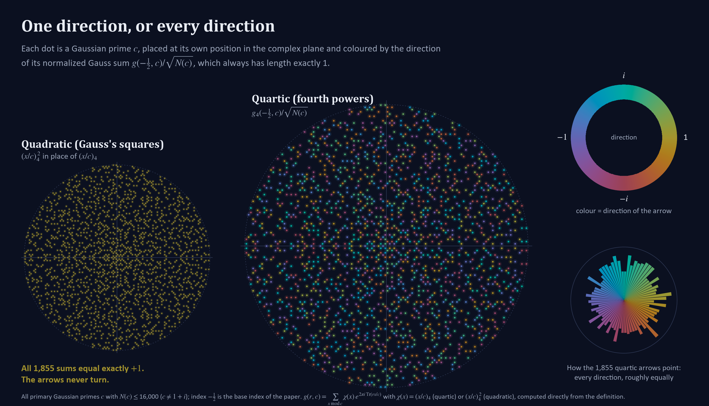
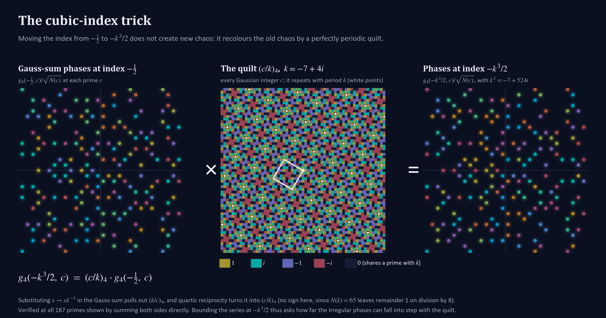
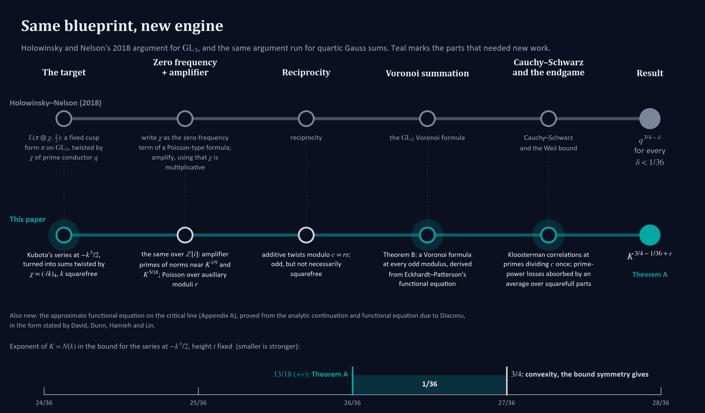

# Beyond Symmetry: A New Bound on the Hidden Rhythms of Quartic Gauss Sums

*By building an all-moduli "mathematical prism" on a four-sheeted covering group, a new paper adapts a modern amplification strategy to break the convexity barrier for Kubota’s Dirichlet series along an infinite family of indices.*

**Paper:** [paper.pdf](paper.pdf) (46 pages; the AI disclosure is under the abstract on page 1).

In 1801, Carl Friedrich Gauss confronted a deceptively simple puzzle about prime numbers and the unit circle. For an odd prime $p$, run through the remainders $x = 0, 1, \dots, p-1$ and plot the complex roots of unity $\exp(2\pi i x^2/p)$ on the unit circle. Each point is a unit arrow pointing outward at an angle set by the square $x^2$ modulo $p$.

Add $p$ randomly oriented unit arrows, and they partially cancel to a length of roughly $\sqrt{p}$. Gauss discovered that his quadratic sums always have length *exactly* $\sqrt{p}$, with their direction locked along the positive real axis when $p \equiv 1 \pmod 4$, or the positive imaginary axis when $p \equiv 3 \pmod 4$. Proving why that sign never wavers took Gauss four years, arriving in 1805 "like a sudden flash of lightning."

When mathematicians replaced squares ($x^2$) with cubes ($x^3$) or fourth powers ($x^4$), that rigid predictability vanished. For fourth powers—*quartic* Gauss sums—the natural setting is the Gaussian integers $\mathbb{Z}[i]$, a square grid in the complex plane. For an odd, squarefree modulus $c \in \mathbb{Z}[i]$ and an "index" $a$ coprime to $c$, the quartic Gauss sum $g_4(a,c)$ weights an additive wave by the quartic residue symbol $(x/c)_4 \in \{\pm 1, \pm i\}$.

Each $g_4(a,c)$ still has length $\sqrt{\operatorname{N}(c)}$, where $\operatorname{N}(c) = |c|^2$. Yet as $c$ varies, the normalized phases $g_4(a,c)/\sqrt{\operatorname{N}(c)}$ spin around the unit circle in a seemingly chaotic dance. To measure how much those spinning arrows cancel across moduli $c$, number theorists bundle them into a generating function—and a new preprint, *"A Subconvex Bound in the Index Aspect for the Dirichlet Series of Quartic Gauss Sums,"* proves that along an infinite family of indices, the arrows cancel significantly more than symmetry guarantees.

*Figure 1. Each dot is a Gaussian prime c with N(c) ≤ 16,000 (1,855 in all), coloured by the direction of its normalized Gauss sum at index −1/2. Left: the quadratic sums all equal exactly +1, so every arrow points the same way. Right: the quartic sums spread across the whole circle (506, 464, 427 and 458 primes in its four quarter-turns).*

### The Metaplectic World and the Free Lunch of Convexity

In the 1960s and 1970s, Tomio Kubota and S. J. Patterson showed why higher-order Gauss sums resist classical tools. Ordinary modular forms live on matrix groups like $\operatorname{GL}_2$, with clean prime-by-prime multiplicative rules. Quartic Gauss sums instead appear in the Fourier coefficients of *metaplectic forms*—waves on four-sheeted arithmetic covering groups of $\operatorname{GL}_2$, where multiplication is twisted by fourth-power residue symbols.

Kubota packaged the quartic Gauss sums at index $a$ into a Dirichlet series, $\psi(a,s;v)$, summing $g_4(a,c)(\bar{c}/|c|)\operatorname{N}(c)^{-s}$ over moduli $c \equiv v \pmod 4$. Like the Riemann zeta function, Kubota’s series converges for $\operatorname{Re}(s) > 3/2$ and continues across the complex plane via a functional equation centered on the *critical line* $\operatorname{Re}(s) = 1$.

On the critical line, symmetry and complex analysis provide a baseline estimate for free—the *convexity bound*—guaranteeing growth no faster than $\operatorname{N}(a)^{1/4}$ (up to arbitrarily small powers). For cubic-form indices $\rho = -k^3/2$, where $k \in \mathbb{Z}[i]$ is squarefree of norm $K = \operatorname{N}(k)$, $\operatorname{N}(\rho)$ is proportional to $K^3$, placing the convexity bound at $K^{3/4}$. Shaving any fixed fraction off that exponent—proving a *subconvex bound*—is a central benchmark in analytic number theory.

### What Was Previously Known

Recent breakthroughs on Gauss sums have left a sharp divide between *average* bounds over all indices and *pointwise* bounds for individual indices.

In 2024, Alexander Dunn and Maksym Radziwiłł proved Patterson’s conjecture on the statistical bias of cubic Gauss sums over primes under the Generalized Riemann Hypothesis (GRH), noting that one of two ways to bypass GRH unconditionally "would be to obtain 'subconvex' bounds in the $r$ aspect for the Dirichlet series" of cubic Gauss sums.

In the quartic case over $\mathbb{Q}(i)$, C. Castillo, A. de Faveri, and Dunn recently proved non-vanishing for a positive proportion of quartic Hecke $L$-functions using only the convexity bound, observing that optimal pointwise bounds for the quartic series are unavailable. Meanwhile, C. David, de Faveri, Dunn, and J. Stucky proved sharp average bounds over the index for the cubic series, and de Faveri, Dunn, and J. Hoffstein noted that the quartic analogue follows via Rankin–Selberg theory. Yet average bounds say nothing beyond convexity about any single index, nor about a thin, zero-density family like $\rho = -k^3/2$.

### What Is New: A Metaplectic Prism for Every Odd Modulus

The new paper breaks the convexity barrier on the critical line along the indices $\rho = -k^3/2$. For a primary, squarefree Gaussian integer $k$ of norm $K = \operatorname{N}(k)$, it lowers the exponent of $K$ from the convexity baseline of $3/4$ to $13/18$—saving $1/36$ (or from $1/4$ to $13/54$, saving $1/108$, in the index norm $\operatorname{N}{(\rho)}$).

The proof combines three main ingredients:

* **The cubic-index trick:** Because $k^3$ is a cube, *quartic reciprocity* converts the $k^3$ index shift inside the Gauss sum into a multiplicative quartic character $\chi(c) = (c/k)_4$. Using an identity of Castillo, de Faveri, and Dunn and an approximate functional equation derived from A. Diaconu and T. Suzuki (as stated by David, Dunn, A. Hamieh, and H. Lin), the problem reduces to bounding smooth sums of fixed-index Kubota coefficients twisted by $\chi$ at lengths around $K^{3/2}$.

  

  *Figure 2. The cubic-index trick, with k = −7+4i. Left: quartic Gauss-sum phases at index −1/2, scattered with no visible pattern. Middle: the four-colour quilt (c/k)₄, which repeats every k. Right: the phases at index −k³/2, which equal left times middle exactly (checked at all 187 primes shown).*
* **An all-moduli Voronoi formula:** The author adapts a 2018 method of Roman Holowinsky and Paul D. Nelson, who proved the same $1/36$ saving for $\operatorname{GL}_3$ cusp forms by writing $\chi$ as the "zero-frequency" mode of a Poisson expansion over an auxiliary modulus $r$, tuning a prime "amplifier" to boost the signal, and applying reciprocity to produce additive waves modulo $c = rs$. Running this engine requires a *Voronoi summation formula*—a mathematical prism transforming a long sum weighted by an additive wave modulo $c$ into a shorter dual sum. Because sieving $r$ to squarefree values would blow up the Poisson error, the paper’s core achievement (Theorem B) is to derive this Voronoi prism for *every* odd modulus $c$, squarefree or not, from C. Eckhardt and Patterson’s 1992 functional equation for the ramified quartic Kubota series. After a "fourth-power peel" strips away prime fourth powers, single prime factors of $c$ yield twisted Kloosterman sums bounded via André Weil’s theorem, while higher prime powers exhibit square-root cancellation via a $p$-adic logarithm evaluation.
* **Balancing the error terms:** With Theorem B in place, Holowinsky and Nelson’s parameters carry over intact: the rarity of large squarefull parts among the moduli absorbs the prime-power losses, and at length $K^{3/2}$ the diagonal and off-diagonal terms meet at the exponent $13/18$.

*Figure 3. Holowinsky and Nelson's 2018 argument and the new paper's, station by station. Teal marks where new work was needed. The ruler shows the saving: Theorem A's exponent 13/18 sits 1/36 below the convexity exponent 3/4.*

### Implications for Future Research

While the work is a new preprint—and relies on Eckhardt and Patterson’s 1992 functional equation as stated in the literature—its findings open several paths forward:

* **A reusable Voronoi prism:** Applying, at indices that are units times powers of $1+i$, to the quartic Kubota series at *every* odd modulus $c$ over $\mathbb{Z}[i]$, Theorem B offers a ready-made tool whenever moduli with repeated prime factors cannot be avoided.
* **Bringing $\operatorname{GL}_3$ amplification to covering groups:** The proof shows that Holowinsky and Nelson’s degeneration-to-zero-frequency method can be transplanted to metaplectic Dirichlet series, despite the lack of standard Euler products.
* **A stepping stone toward general indices and cubic sums:** Because the argument uses reciprocity to turn the cubic index $-k^3/2$ into a character twist, arbitrary indices $a$ remain an open frontier. Still, combining an all-moduli metaplectic Voronoi formula with additive delta-method techniques offers a natural blueprint for general indices—and for analogous tools on the threefold cover over $\mathbb{Z}[e^{2\pi i/3}]$, a first step toward the subconvexity question Dunn and Radziwiłł raised for cubic Gauss sums.
